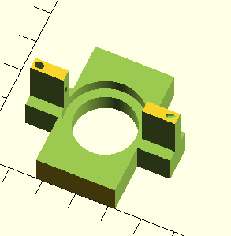
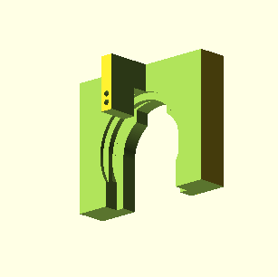
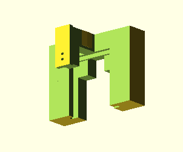
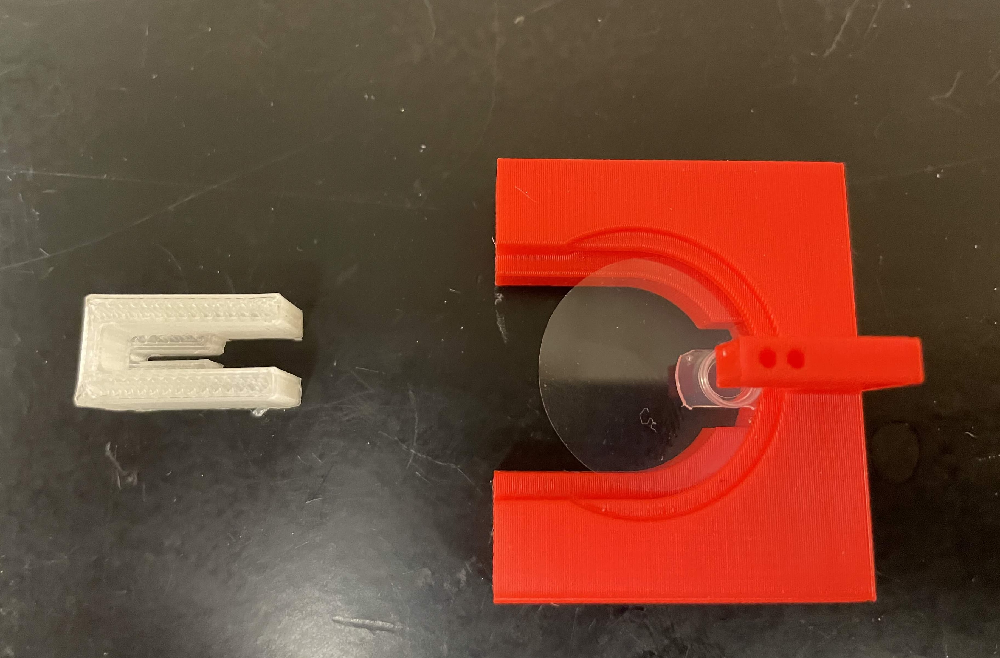
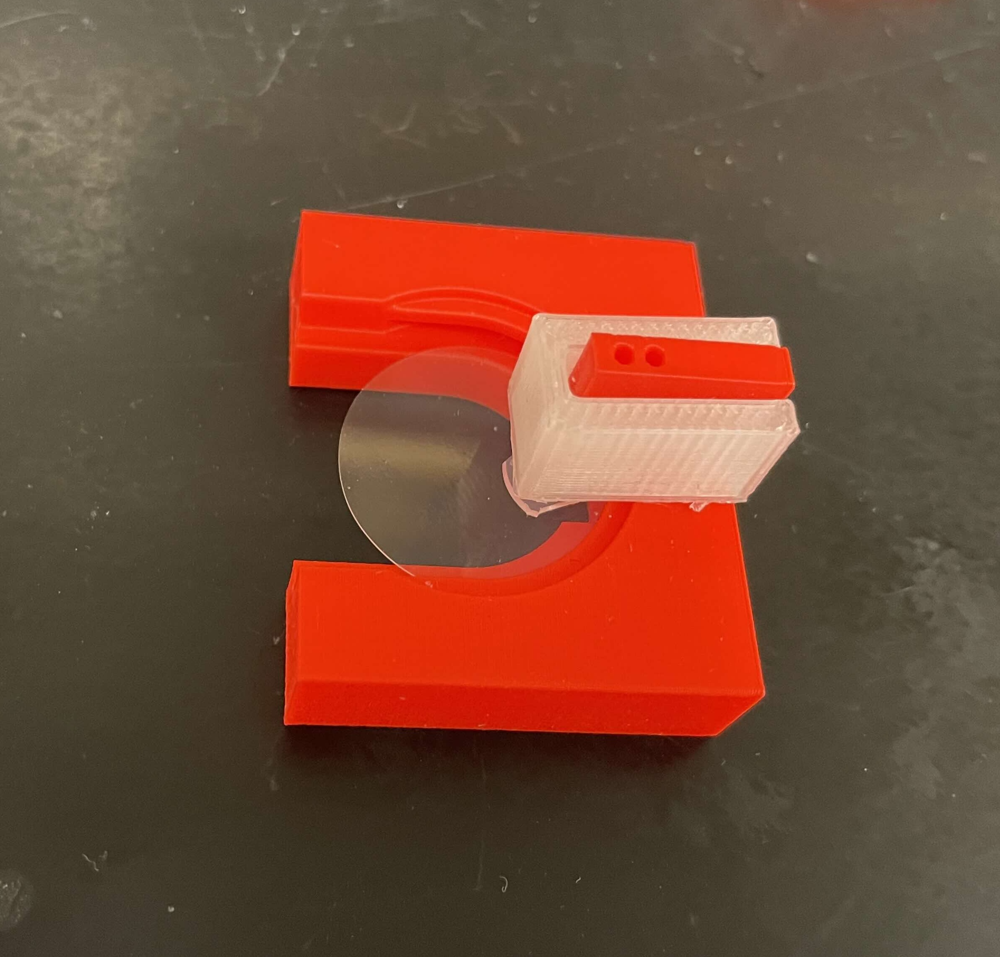
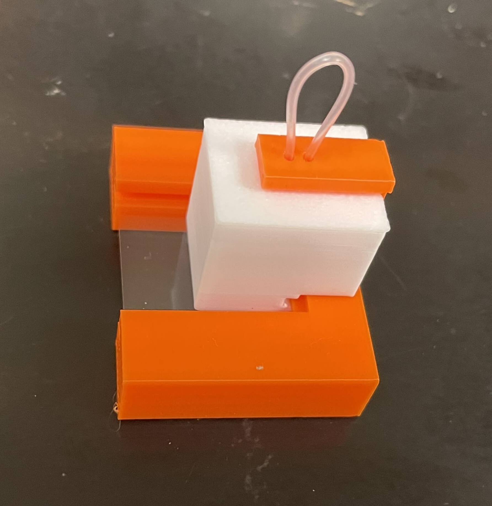
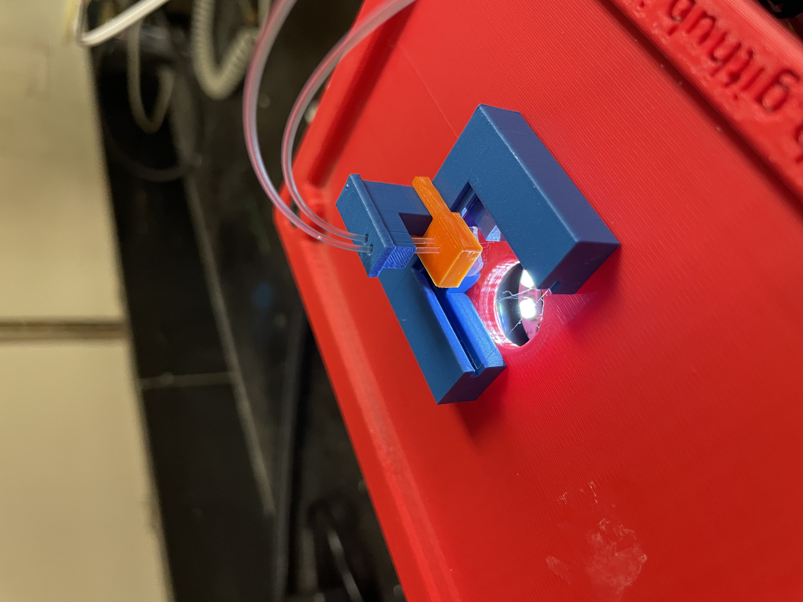
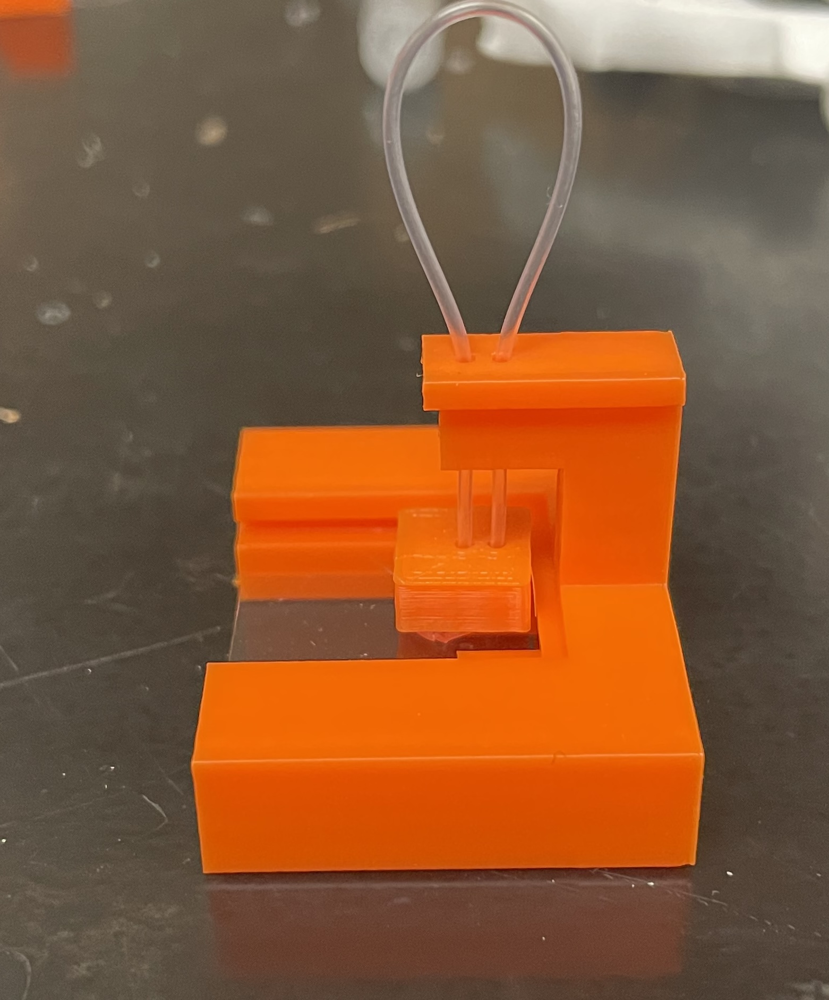

## Title: Obj06 Auto serial equilibration sample holders
## Date: 2024-12-06 (notes date; exps from 2022)
## Goals: To develop and test use sample holders for auto equilibration system

2025-05-30.

### Sample holder
Original holder was developed in 2022. 
#### Version 1
This has two ports for tubing, the idea being to have the crystals in a drop.  

#### Version 2
The tubing ports are now coming from the pillar at the top. The crystal sits in a "pot", which is an inverted pcr cap. The pot sits on a round coverslip.  

#### Version 3 - square
Like version 3, but:
- square coverslip
- includes the possibility of a cover  

2025-10-13.
Testing different hole diameters to work with Warner PE-50 tubing (OD=0.97 mm)
| Hole diameter | Printer | Result |
|---------------|---------|--------|
| 0.82          | Raise3D	| Too small	|
| 0.82			| H2D		| Too small	|
| 1.5			| Raise3D	| Too large - tubing doesn't stick |
| 1.5			| H2D		| Too large - tubing doesn't stick |
| 1.2			| Raise3D	|  |
| 1.2			| H2D		| Good size - tubing can be pushed through relatively easily, but then stays put |

### Cover. Development started in 2025. 
#### Version 1.
This simply sits on top of the pot, with a slot for the tubing. 

#### Version 2. 
This slides over the whole pot assembly. 

The tables below measure evaporation of water from the system. Masses in grams are given.
RH ~30-40%
Rates are given in mg/hour
5/20/22
| Time (m:s)| No Cover (g) 	| Change (0.1 mg) 	|Rate 	| Time 	| Cover v2 (PLA) 	| Change 	| Rate	|
|-----------|---------------|-------------------|----	|----	|-----------		|----------	|------	|
| 0     	| 5.3192   		| - 				| -		| 0:24 	| 7.6826 			| - 		| -		|
| 15:40		| 5.3173		| 19				| 7.6	| 16:00	| 7.6819			|	7		| 2.6	|
| 34:00		| 5.3150		| 42				| 7.4	| 34:30	| 7.6807			|	19		| 3.3	|
| 60:00		| 5.3120		| 72				| 7.2	| 61:00	| 7.6793 			|	33		| 3.3	|
| 90:00		| 5.3081		| 109				| 7.3	| 90:00	| 7.6772			|	54		| 3.6	|

| Time (m:s)| Cover v2 (PP) | Change (0.1 mg) 	| Rate	|Time 	| Cover v1 (PP) 	| Change 	| Rate	|
|-----------|---------------|-------------------|-----	|----	|-----------		|----------	|------	|
| 0     	| 7.3913   		| - 				| -		| 0:00 	| 6.7478 			| - 		| - 	|
| 15:00		| 7.3903		| 10				| 4.0	| 15:30	| 6.7468			|	10		| 3.9	|

5/21/22
| Time (m:s)| No Cover		| Change (0.1 mg) 	| Rate	|Time 	| Cover v2 (PLA) 	| Change 	| Rate	|
|-----------|---------------|-------------------|----	|----	|-----------		|----------	|------	|
| 0     	| 5.3299   		| - 				| -		| 0 	| 7.4331 			| - 		| - 	|
| 15		| 5.3277		| 22				| 8.8	| 15	| 7.4323			|	8		| 3.2	|
| 30		| 5.3258		| 41				| 8.2	| 30	| 7.4315			|	16		| 3.2	|
--> Covers v1 & v2 have similar effectivenesss, in reducing the evaporation rate by about 50%. 
Positive control for no evaporation:
| Time (m:s)| NC & hum flow	| Change (0.1 mg) 	|Time 	| 
|-----------|---------------|-------------------|----	|
| 0     	| 5.3746   		| - 				| 0 	| 
| 15		| 5.3256		| +10 (!)			| 15	| 

Testing to see how much evaporation occurs through the holes for the tubing.
| Time (m:s)| No Cover		| Change (0.1 mg) 	|Rate 	| Time	| Cov v1 w/holes & no tubing 	| Change 	| Rate 	|
|-----------|---------------|-------------------|----	|------	|-----------					|----------	|-----	|
| 0     	| 5.3303   		| - 				| - 	| 0		| 5.8111 						| - 		| - 	|
| 15		| 5.3286		| 17				| 6.8	| 15	| 5.8102						|	9		| 3.6	|

| Time (m:s)| No Cover		| Change (0.1 mg) 	| Rate	| Time 	| Cov v1 w/holes & + tubing 	| Change 	| Rate	|
|-----------|---------------|-------------------|------	|----	|-----------					|----------	|------	|
| 0     	| 5.3279  		| - 				| - 	| 0 	| 5.8334 						| - 		| - 	|
| 16		| 5.3259		| 20				| 7.5	| 16	| 5.8328						|	6		| 2.2
| 30		| 5.3242		| 37				| 7.4	| 30	| 5.8324						|	10		| 2.0

--> So apparently about 40% of the evaporation with version 1 is through the holes for the tubing...

Now trying to seal the interface between the cover and the glass slide by including some parafilm at the interface.
RH ~ 30%
| Time (m:s)| No Cover		| Change (0.1 mg) 	| Rate	| Time 	| Cov v2 (PLA) & Parafilm 		|	 Change | Rate	|
|-----------|---------------|-------------------|------	|----	|-----------					|----------	|------	|
| 0     	| 5.3219  		| - 				| - 	| 0 	| 7.4782 						| - 		| - 	|
| 15		| 5.3197		| 21				| 8.4	| 15	| 7.4772						|	10		| 4.0
| 37		| 5.3174		| 45				| 7.3	| 37	| 7.4760						|	22		| 3.6

| Time (m:s)| No Cover		| Change (0.1 mg) 	| Rate	| Time 	| Cov v2 (PP) & Parafilm 		|	 Change | Rate	|
|-----------|---------------|-------------------|------	|----	|-----------					|----------	|------	|
| 0     	| 5.3129  		| - 				| - 	| 0 	| 7.0538 						| - 		| - 	|
| 15		| 5.3111		| 18				| 7.6	| 15	| 7.0527						|	11		| 4.4
| 35		| 5.3089		| 40				| 6.9	| 35	| 7.0516						|	22		| 3.8

| Time (m:s)| No Cover		| Change (0.1 mg) 	| Rate	| Time 	| Cov v2 (PLA) & Parafilm 		|	 Change | Rate	|
|-----------|---------------|-------------------|------	|----	|-----------					|----------	|------	|
| 0     	| 5.3082  		| - 				| - 	| 0 	| 7.4207 						| - 		| - 	|
| 15		| 5.3065		| 17				| 7.2	| 15	| 7.4199						|	8		| 3.2	|
| 37		| 5.3045		| 37				| 6.0	| 37	| 7.4189						|	18		| 2.9	|
 ---> This didn't help very much, if at all.
 
 So I hypothesize that v2 is too large - there is too much interfacial area. So I go back to something more like v1, but try to seal the top of the pot better than just having something sitting on top of the pot with slots for tubing. I try:
 - Using holes for the tubing
 - Having the cover actually go down over the edges of the pot.

#### Version 3.

One can have "struts", which help keep the cover in place a little easier when installing, or "no struts", which allows the cover to sit covering the pot more completely. 

 RH ~ 35%
| Time (m:s)| No Cover		| Change/Rate 	| v3 Struts/1mm	| Change/Rate	| v3 No struts/2 mm | Change/Rate 	| 	
|-----------|---------------|------------	|------------	|-----------	|-----------		|----------		|
| 0     	| 5.6157  		| - 			| 5.6008 		| - 			| 5.6134 			| - 			| 
| 24		| 5.6133		| 24/6.0		| 5.6004		| 4/1.0			| 5.6133			|	1/0.3		|
| 44		| 5.6116		| 41/5.6		| 5.6003		| 5/0.7			| 5.6129			|	5/0.7		|
| 60		| 5.6099		| 58/5.8		| 5.5998		| 9/0.9			| 5.6129			|	5/0.5		|

| Time (m:s)| No Cover		| Change/Rate 	| v3 Struts/1mm	| Change/Rate	| v3 No struts/2 mm | Change/Rate 	| 	
|-----------|---------------|------------	|------------	|-----------	|-----------		|----------		|
| 0     	| 5.6119  		| - 			| 5.7409 		| - 			| 5.6116 			| - 			| 
| 20		| 5.6097		| 22/6.6		| 5.7409		| 4/1.2			| 5.6116			|	0/0.0		|
| 63		| 5.6053		| 66/6.3		| 5.7394		| 9/0.9			| 5.6109			|	7/0.7		|

This is much better. 5-10x reduction in evaporation rate. 

##### Printing
Printed using FDM printers (Raise3D Pro 3 with hyperspeed option, or BambuLab A1-mini or H2D) using 0.4 mm nozzles.
Parameters will need to be adjusted depending on printer, tubing and pcr cap. See the header of the scad files.
In sum:
For PE-50 tubing from Warner Instruments
1.25 tubing diameter seems ok for the sample_holder
For cover_V3
tubing_diameter = 1.5 works for Raise3D Pro 3, too small for H2D
tubing_diameter = 1.7 works for H2D